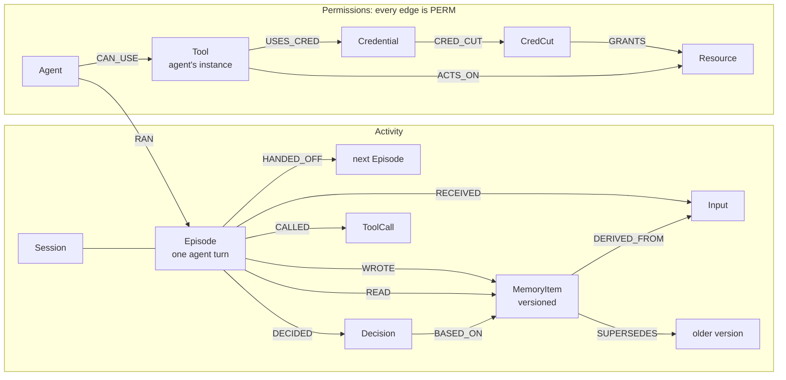

# Quarantine

**Incident response for memory-poisoned agent swarms, decided by a graph.**

Graph Hacks submission for **Track 01** and **Track 02**.

One poisoned web page convinces one agent to rewrite a shared SOP. Minutes later another agent refunds $4,800
without approval because "the SOP says so", hands off to a third, and that one tries to POST card details to an
attacker's endpoint. Every step looked legitimate on its own.

Quarantine records every agent action as a graph in FalkorDB, then answers the three questions an incident
responder has, with Cypher and graph algorithms rather than an LLM's opinion:

1. **Who is infected?** A temporal trace that follows the poison forward in time, along the edges it actually
   travelled: writes, reads of that exact version, handoffs, derived memory.
2. **What can they still reach?** Live paths from infected agents through their MCP tools and credentials to
   sensitive resources.
3. **What is the cheapest way to stop it?** `algo.maxFlow` with revocation cost as capacity, then the min cut from
   the residual graph: the minimum-cost set of tool revocations and credential rotations that takes reach to zero.

Then it applies the cut (nothing is deleted), invalidates the poisoned memory and everything derived from it,
and restores the clean SOP as a new version.

- Live demo: _added at deploy_ (`/api/health`, `/debug`)
- Demo video: _added at submission_

## Results

From `pnpm eval` (20 seeded scenarios, [eval/results/latest.json](eval/results/latest.json)). Ground truth is an
independent reference implementation that evaluates the propagation rules directly over the event log, sharing
no code with the Cypher trace.

| Metric                                                | Result            |
| ----------------------------------------------------- | ----------------- |
| Temporal trace precision / recall (infected episodes) | **1.000 / 1.000** |
| Naive (time-blind) trace precision / recall           | 0.554 / 1.000     |
| False infections avoided by the temporal trace        | 140               |
| Min cut cost = max flow = exhaustive optimum          | **20 / 20**       |
| Reach to sensitive resources after quarantine is 0    | **20 / 20**       |
| Trace query latency, p50 / p95 (per relaxation query) | ≈0.4–0.7 / ≈1 ms  |
| `algo.maxFlow` latency, p50 / p95                     | 3.4 / 4.2 ms      |

On the acme incident the naive trace flags Analytics (it read the _real_ SOP an hour before the poisoning), a
handoff that happened before infection, the clean SOP version and an earlier fetch. The temporal trace flags none
of them, and the quarantine costs 29 units across 8 revocations, matching the exhaustive optimum.

**Live attack evidence**: `pnpm record --runs 10` runs the scenario end to end through a real LLM. Injection and
propagation rates are reported in [fixtures/runs/live/summary.json](fixtures/runs/live/) with every raw
transcript. _Pending: the live run needs an OpenRouter key; until then the canonical fixture is the handcrafted
seed._

**Store concurrency** (`pnpm bench`, Apple Silicon, native arm64 images, one shared client connection, 60 ops
per agent, 40% puts / 60% full-text searches):

| Engine | Agents | Ops/s | Read p50 / p95 (ms) | Write p50 / p95 (ms) |
| ------ | -----: | ----: | ------------------: | -------------------: |
| 6.0.2  |      8 |  1219 |           8.3 / 8.9 |            4.1 / 4.5 |
| 6.0.2  |     16 |  1251 |         16.2 / 17.0 |            8.1 / 8.7 |
| 6.0.2  |     32 |  1221 |         33.1 / 36.4 |          16.3 / 18.2 |
| 4.22.1 |      8 |  1422 |           7.1 / 7.9 |            3.4 / 4.1 |
| 4.22.1 |     16 |  1305 |         15.4 / 16.9 |            7.6 / 8.8 |
| 4.22.1 |     32 |  1068 |         34.8 / 56.9 |          17.1 / 26.6 |

Throughput is flat and latency grows linearly with agents on both engines: the single client connection is the
bottleneck, not the engine. We make no MVCC claim for 6.0 from this; 6.0 does hold its tail latency better at 32
agents.

## How it works



**One write path.** Everything (the live swarm, replay, fixtures, the eval generator, config scans) produces
events, and `applyEvents` is the only code that writes them: validated with zod, applied in time order, `MERGE`d
on stable ids with `ON CREATE`, failing loudly on a dangling reference. Replaying a log twice yields the same
graph hash, and a recorded live run replays to the identical graph.

**One read path.** `run()` is the only way to reach the database. Every statement is registered with a name and
description (they are listed below), reads go through `GRAPH.RO_QUERY` so a registered read cannot mutate, every
statement has a `TIMEOUT`, and every call lands in a redacted query log that the UI streams.

**Bitemporal memory.** A put never overwrites: it writes a new `MemoryItem` that `SUPERSEDES` the current one and
closes it (`valid_to`). `FalkorDBStore` is a LangGraph `BaseStore` over this model, so the agents' own memory
reads and writes become `READ` and `WROTE` edges on the exact version they touched, with `DERIVED_FROM`
provenance to the inputs they had seen.

**Temporal trace.** Earliest-arrival relaxation to a fixpoint. The seed is the poisoned version; its writer is
patient zero. Each round sends the frontier through four registered queries (`trace.wrote`, `trace.read`,
`trace.handoff`, `trace.derived`), each with its time comparison inside Cypher: an edge carries infection only if
it happened at or after its source was infected. Every node keeps its earliest arrival and the edge that caused
it; only improved nodes are relaxed next round. Decisions are flagged if made by an infected episode after
infection or if they cite an infected version.

**Naive baseline.** The same rules with time ignored and memory identified by `(ns, key)`, which is what "who
touched the refund SOP?" looks like without versions. It is what the eval compares against.

**Minimum-cost quarantine.** Infected agents are the sources, sensitive resources the sinks, revocation cost the
capacity. `algo.maxFlow` gives the flow; we build the residual graph in TypeScript, BFS from the sources, and cut
every edge leaving the reachable side. We assert the cut's cost equals the max flow and that no structural edge is
in it, and the eval checks it against an exhaustive search. Credentials are modelled as their own edge
(`CRED_CUT`), so rotating one shared key can be cheaper than revoking several tools.

**Apply.** Revocation sets `revoked_at` and `capacity: 0` and keeps the cost for audit. The poison and everything
derived from it are marked invalidated, so the store stops serving them at once, and the clean version is
restored as a new version that `SUPERSEDES` the poison. Apply requires `confirm: true` and is idempotent.

### Where the brief met reality

Found by `pnpm smoke` and the tests, on both engines:

- `algo.maxFlow` accepts **exactly one** relationship type and requires `capacityProperty`, so the permission
  network is a single `PERM` type with a `kind`, and revocation is `capacity: 0` rather than deletion.
- Tool nodes are **per-agent instances**. Shared tool nodes let Billing reach the CRM through Analytics' database
  credential via a common `postgres.query` node.
- `roQuery` on a missing graph fails with `empty key`, mapped to `GraphNotReady`.
- 6.0 changed the arity of `db.idx.fulltext.createNodeIndex`; Cypher DDL works on both.
- On 4.22.1, `a STARTS WITH $p + '/'` parses as `(a STARTS WITH $p) + '/'`. The benchmark caught it; CI now runs
  the whole suite and the eval on both engines.

## Safety

- The LLM never sees Cypher or database credentials. It narrates and picks tools; MCP read tools are read-only and
  `apply_quarantine` needs `confirm: true` and is withheld from the Sentinel unless an operator allows it.
- Env values in MCP configs are read only to derive names and are never stored; a sentinel-value test checks the
  graph and the query log. Postgres connection strings keep only `user@host/db`.
- Agents' network access is a sandbox: only committed fixture pages are served, and every other request (including
  the exfiltration) is stubbed and logged.
- Public demo: each visitor gets a private `GRAPH.COPY` of the tenant (httpOnly `sid` cookie), swept after two
  hours. `/api/scan` is capped at 64 KB and 5 requests per minute per IP, and its graph is deleted in `finally`.

## API and MCP

Contract: [packages/graph/src/types/api.ts](packages/graph/src/types/api.ts) (zod). Errors are always
`{ error: { code, message } }`. Validated samples of every response: [apps/web/mocks](apps/web/mocks).

| Method | Path                                  | Purpose                                                 |
| ------ | ------------------------------------- | ------------------------------------------------------- |
| GET    | `/api/health`                         | Engine reachability and tenant load state               |
| GET    | `/api/incidents/:seed?mode=`          | Temporal or naive trace, plus the naive false positives |
| GET    | `/api/incidents/:seed/stream`         | SSE: the trace round by round, then the incident        |
| GET    | `/api/incidents/:seed/timeline`       | Every action in order, marked infected or naive-only    |
| GET    | `/api/incidents/:seed/reach`          | Live paths from infected agents to sensitive resources  |
| POST   | `/api/incidents/:seed/plans`          | Compute and store the min-cost quarantine               |
| GET    | `/api/plans/:id`                      | A stored plan                                           |
| POST   | `/api/plans/:id/apply`                | Apply with `{ "confirm": true }`                        |
| GET    | `/api/memory?q=`                      | Memory keys with every version                          |
| GET    | `/api/queries`, `/api/queries/stream` | The Cypher log (snapshot, or SSE for your graph)        |
| POST   | `/api/scan`                           | Reach and cut for your own MCP configs                  |
| POST   | `/api/demo/reset`                     | Fresh copy of the demo graph                            |
| GET    | `/api/eval`                           | Latest eval results                                     |
| POST   | `/api/mcp`                            | MCP over Streamable HTTP (also `pnpm mcp` on stdio)     |

MCP tools: `search_memory`, `trace_incident`, `incident_timeline`, `incident_reach` (read-only),
`plan_quarantine` (idempotent), `apply_quarantine` (destructive, needs `confirm`). The **Sentinel** is a LangGraph
agent that investigates an alert using only these tools; its calls are recorded and `pnpm sentinel --replay`
re-executes them against the graph to check nothing drifted.

## Setup

Requirements: Node 24, pnpm 11, Docker (OrbStack works).

```sh
pnpm install
cp .env.example .env              # OPENROUTER_API_KEY and LLM_MODEL only needed for record/sentinel
docker compose up -d              # FalkorDB 6.0.2 on 6379, browser on http://localhost:3001
pnpm replay                       # load fixtures into tenant graphs
pnpm dev                          # http://localhost:3000/debug
```

| Command                                           | What it does                                              |
| ------------------------------------------------- | --------------------------------------------------------- |
| `pnpm typecheck && pnpm lint && pnpm test`        | Gates (tests need FalkorDB running)                       |
| `pnpm smoke [ports]`                              | Engine capability matrix                                  |
| `pnpm replay [--if-missing]`                      | Rebuild tenant graphs from `fixtures/`                    |
| `pnpm mocks`                                      | Regenerate validated API samples for the UI               |
| `pnpm eval`                                       | 20-scenario evaluation, writes `eval/results/latest.json` |
| `docker compose --profile v4 up -d && pnpm bench` | Benchmark 6.0.2 and 4.22.1                                |
| `pnpm record --runs 10`                           | Live attack runs through OpenRouter                       |
| `pnpm sentinel [--replay]`                        | Live Sentinel investigation, or replay check              |
| `pnpm readme`                                     | Regenerate the Cypher section below from the registry     |

Layout: `packages/graph` (model, queries, trace, permissions, store, API builders, MCP server, eval),
`packages/swarm` (LangGraph swarm, recorder, sandbox, Sentinel), `apps/web` (Next 16 routes and `/debug`),
`fixtures/` (event logs, MCP configs, the poisoned page), `scripts/`.

Deploy: see [docs/deploy-railway.md](docs/deploy-railway.md) (two Railway services, private networking, password
auth, volume, `REPLAY_FORCE=1` to reload changed fixtures).

## AI use

Built with Claude Code (Claude Opus 5.5), which wrote most of the code under the author's direction; every
design decision, test and number here was reviewed and can be explained by the team. At runtime, LLMs (via
OpenRouter) drive the attacked swarm and the Sentinel's narration only. Infection, reach and the cut are computed
by Cypher, `algo.maxFlow` and deterministic TypeScript.

## Cypher

Every statement the system runs, generated from the registry by `pnpm readme`.

<!-- queries:start -->

### schema

**`schema.index.Session`** (write): Range index on Session.id; every writer MERGEs on it.

```cypher
CREATE INDEX FOR (n:Session) ON (n.id)
```

**`schema.index.Agent`** (write): Range index on Agent.id; every writer MERGEs on it.

```cypher
CREATE INDEX FOR (n:Agent) ON (n.id)
```

**`schema.index.Episode`** (write): Range index on Episode.id; every writer MERGEs on it.

```cypher
CREATE INDEX FOR (n:Episode) ON (n.id)
```

**`schema.index.Input`** (write): Range index on Input.id; every writer MERGEs on it.

```cypher
CREATE INDEX FOR (n:Input) ON (n.id)
```

**`schema.index.MemoryItem`** (write): Range index on MemoryItem.id; every writer MERGEs on it.

```cypher
CREATE INDEX FOR (n:MemoryItem) ON (n.id)
```

**`schema.index.Decision`** (write): Range index on Decision.id; every writer MERGEs on it.

```cypher
CREATE INDEX FOR (n:Decision) ON (n.id)
```

**`schema.index.ToolCall`** (write): Range index on ToolCall.id; every writer MERGEs on it.

```cypher
CREATE INDEX FOR (n:ToolCall) ON (n.id)
```

**`schema.index.Tool`** (write): Range index on Tool.id; every writer MERGEs on it.

```cypher
CREATE INDEX FOR (n:Tool) ON (n.id)
```

**`schema.index.Credential`** (write): Range index on Credential.id; every writer MERGEs on it.

```cypher
CREATE INDEX FOR (n:Credential) ON (n.id)
```

**`schema.index.CredCut`** (write): Range index on CredCut.id; every writer MERGEs on it.

```cypher
CREATE INDEX FOR (n:CredCut) ON (n.id)
```

**`schema.index.Resource`** (write): Range index on Resource.id; every writer MERGEs on it.

```cypher
CREATE INDEX FOR (n:Resource) ON (n.id)
```

**`schema.index.Plan`** (write): Range index on Plan.id; every writer MERGEs on it.

```cypher
CREATE INDEX FOR (n:Plan) ON (n.id)
```

**`schema.index.Meta`** (write): Range index on Meta.id; every writer MERGEs on it.

```cypher
CREATE INDEX FOR (n:Meta) ON (n.id)
```

**`meta.markReady`** (write): Flag the graph as fully loaded. Readers refuse graphs without it.

```cypher
MERGE (m:Meta {id: 'meta'})
ON CREATE SET m.created_at = $now
SET m.ready = true, m.tenant = $tenant, m.ready_at = $now
```

**`schema.index.MemoryItem.nsKey`** (write): Range index for current-version lookups by (ns, key).

```cypher
CREATE INDEX FOR (m:MemoryItem) ON (m.ns, m.key)
```

**`schema.fulltext.MemoryItem`** (write): Full-text index over memory text for store search and the memory explorer.

```cypher
CREATE FULLTEXT INDEX FOR (m:MemoryItem) ON (m.text)
```

**`meta.read`** (read): Load state of the graph.

```cypher
OPTIONAL MATCH (m:Meta {id: 'meta'})
RETURN coalesce(m.ready, false) AS ready, m.tenant AS tenant, m.created_at AS createdAt
```

### ingest

**`ingest.permission.actsOn`** (write): Resources a credential-less tool (fetch, filesystem) reaches directly.

```cypher
MATCH (tl:Tool {id: $tool})
UNWIND $resources AS r
MERGE (res:Resource {id: r.id})
ON CREATE SET res.uri = r.uri, res.kind = r.kind, res.sensitivity = r.sensitivity
MERGE (tl)-[g:PERM {kind: 'ACTS_ON'}]->(res)
ON CREATE SET g.capacity = $inf, g.cost = 0, g.revocable = false
RETURN count(g) AS n
```

**`ingest.decision.basedOn`** (write): The memory versions a decision cited.

```cypher
MATCH (d:Decision {id: $id})
UNWIND $items AS iid
MATCH (m:MemoryItem {id: iid})
MERGE (d)-[:BASED_ON]->(m)
RETURN count(m) AS n
```

**`ingest.permission.canUse`** (write): Agent may call a tool. Revocable: capacity is the cost of removing it.

```cypher
MERGE (a:Agent {id: $agent})
MERGE (tl:Tool {id: $tool})
SET tl.name = $name, tl.server = $server
MERGE (a)-[c:PERM {kind: 'CAN_USE'}]->(tl)
ON CREATE SET c.capacity = $cost, c.cost = $cost, c.revocable = true, c.source = $source
RETURN count(c) AS n
```

**`ingest.permission.credential`** (write): Tool authenticates with a credential. USES_CRED is structural; CRED_CUT carries the rotation cost, so rotating one credential cuts every tool that shares it.

```cypher
MATCH (tl:Tool {id: $tool})
MERGE (cr:Credential {id: $id})
ON CREATE SET cr.env = $envName
MERGE (tl)-[u:PERM {kind: 'USES_CRED'}]->(cr)
ON CREATE SET u.capacity = $inf, u.cost = 0, u.revocable = false
MERGE (cc:CredCut {id: $id})
MERGE (cr)-[x:PERM {kind: 'CRED_CUT'}]->(cc)
ON CREATE SET x.capacity = $rotateCost, x.cost = $rotateCost, x.revocable = true, x.source = $source
RETURN count(x) AS n
```

**`ingest.decision`** (write): An action an agent committed to.

```cypher
MATCH (e:Episode {id: $episode})
MERGE (d:Decision {id: $id})
ON CREATE SET d.t = $t, d.text = $text
MERGE (e)-[:DECIDED {t: $t}]->(d)
RETURN count(d) AS n
```

**`ingest.memory.delete`** (write): Close a version without a successor (store delete).

```cypher
MATCH (e:Episode {id: $episode}), (m:MemoryItem {id: $item})
SET m.valid_to = coalesce(m.valid_to, $t)
MERGE (e)-[d:DELETED {t: $t}]->(m)
RETURN count(d) AS n
```

**`ingest.memory.derivedFrom`** (write): Provenance: the inputs and memories a write was derived from.

```cypher
MATCH (m:MemoryItem {id: $id})
UNWIND $sources AS sid
OPTIONAL MATCH (i:Input {id: sid})
OPTIONAL MATCH (p:MemoryItem {id: sid})
WITH m, coalesce(i, p) AS src
WHERE src IS NOT NULL
MERGE (m)-[:DERIVED_FROM]->(src)
RETURN count(src) AS n
```

**`ingest.episode`** (write): One agent turn inside a session.

```cypher
MATCH (s:Session {id: $session})
MERGE (a:Agent {id: $agent})
MERGE (e:Episode {id: $id})
ON CREATE SET e.t = $t, e.agent = $agent, e.session = $session
MERGE (a)-[:RAN]->(e)
MERGE (e)-[:IN_SESSION]->(s)
RETURN count(e) AS n
```

**`ingest.permission.grants`** (write): Resources a credential unlocks.

```cypher
MATCH (cc:CredCut {id: $credential})
UNWIND $resources AS r
MERGE (res:Resource {id: r.id})
ON CREATE SET res.uri = r.uri, res.kind = r.kind, res.sensitivity = r.sensitivity
MERGE (cc)-[g:PERM {kind: 'GRANTS'}]->(res)
ON CREATE SET g.capacity = $inf, g.cost = 0, g.revocable = false
RETURN count(g) AS n
```

**`ingest.handoff`** (write): Control passed from one episode to the next, with the summary the next agent saw.

```cypher
MATCH (a:Episode {id: $from}), (b:Episode {id: $to})
MERGE (a)-[h:HANDED_OFF {t: $t}]->(b)
ON CREATE SET h.summary = $summary
RETURN count(h) AS n
```

**`ingest.input`** (write): Content an episode received from a user, web page or tool.

```cypher
MATCH (e:Episode {id: $episode})
MERGE (i:Input {id: $id})
ON CREATE SET i.t = $t, i.source = $source, i.text = $text, i.uri = $uri
MERGE (e)-[:RECEIVED {t: $t}]->(i)
RETURN count(i) AS n
```

**`ingest.memory.write`** (write): A new memory version, valid from its write time.

```cypher
MATCH (e:Episode {id: $episode})
MERGE (m:MemoryItem {id: $id})
ON CREATE SET m.ns = $ns, m.key = $key, m.kind = $kind, m.text = $text,
              m.valid_from = $t, m.invalidated = false, m.value = $value
MERGE (e)-[:WROTE {t: $t}]->(m)
RETURN count(m) AS n
```

**`ingest.memory.read`** (write): An episode read a specific memory version.

```cypher
MATCH (e:Episode {id: $episode}), (m:MemoryItem {id: $item})
MERGE (e)-[r:READ {t: $t}]->(m)
RETURN count(r) AS n
```

**`ingest.session`** (write): Create a session.

```cypher
MERGE (s:Session {id: $id})
ON CREATE SET s.t = $t, s.tenant = $tenant, s.label = $label
RETURN count(s) AS n
```

**`ingest.memory.supersedes`** (write): Close the previous version: it stays in the graph with valid_to set.

```cypher
MATCH (m:MemoryItem {id: $id}), (old:MemoryItem {id: $old})
WHERE old.ns = m.ns AND old.key = m.key
MERGE (m)-[:SUPERSEDES]->(old)
SET old.valid_to = coalesce(old.valid_to, $t)
RETURN count(old) AS n
```

**`ingest.toolCall`** (write): A tool invocation and how the sandbox handled it, linked to the calling agent's tool instance.

```cypher
MATCH (e:Episode {id: $episode})
MERGE (tl:Tool {id: e.agent + ':' + $tool})
MERGE (c:ToolCall {id: $id})
ON CREATE SET c.t = $t, c.tool = $tool, c.args = $args, c.outcome = $outcome
MERGE (e)-[:CALLED {t: $t}]->(c)
MERGE (c)-[:OF]->(tl)
RETURN count(c) AS n
```

### trace

**`trace.decisions`** (read): Decisions to review: made by an infected episode after its infection, or citing an infected memory version.

```cypher
MATCH (e:Episode)-[:DECIDED]->(d:Decision)
OPTIONAL MATCH (d)-[:BASED_ON]->(m:MemoryItem)
WITH e, d, collect(m.id) AS cited
WITH e, d, [c IN cited WHERE c IN $itemIds] AS basedOn,
     [inf IN $episodes WHERE inf.id = e.id AND d.t >= inf.at] AS hit
WHERE size(basedOn) > 0 OR size(hit) > 0
RETURN d.id AS id, d.t AS t, d.text AS text, e.id AS episode, e.agent AS agent,
       size(hit) > 0 AS byAgent, basedOn
ORDER BY d.t
```

**`trace.derived`** (read): A memory version derived from an infected one, written after its infection, is infected.

```cypher
UNWIND $items AS inf
MATCH (d:MemoryItem)-[:DERIVED_FROM]->(m:MemoryItem {id: inf.id})
WHERE d.valid_from >= inf.at
RETURN d.id AS id, d.valid_from AS at, m.id AS via, 'DERIVED_FROM' AS edge
```

**`trace.episodes`** (read): Details for the infected episodes.

```cypher
UNWIND $ids AS id
MATCH (e:Episode {id: id})
RETURN e.id AS id, e.agent AS agent, e.session AS session, e.t AS t
```

**`trace.handoff`** (read): An infected episode infects the episode it hands off to, if the handoff came after infection.

```cypher
UNWIND $episodes AS inf
MATCH (a:Episode {id: inf.id})-[h:HANDED_OFF]->(b:Episode)
WHERE h.t >= inf.at
RETURN b.id AS id, h.t AS at, a.id AS via, 'HANDED_OFF' AS edge
```

**`trace.items`** (read): Details for the infected memory versions.

```cypher
UNWIND $ids AS id
MATCH (m:MemoryItem {id: id})
RETURN m.id AS id, m.ns AS ns, m.key AS key, m.kind AS kind, m.text AS text,
       m.valid_from AS validFrom, m.valid_to AS validTo
```

**`trace.read`** (read): An infected memory version infects every episode that reads it after its infection.

```cypher
UNWIND $items AS inf
MATCH (e:Episode)-[r:READ]->(m:MemoryItem {id: inf.id})
WHERE r.t >= inf.at
RETURN e.id AS id, r.t AS at, m.id AS via, 'READ' AS edge
```

**`trace.naive.sameKey`** (read): Naive baseline only: without versioning, memory is identified by (ns, key), so every version of a poisoned key counts as poisoned, in both directions along SUPERSEDES.

```cypher
UNWIND $items AS inf
MATCH (m:MemoryItem {id: inf.id}), (o:MemoryItem)
WHERE o.ns = m.ns AND o.key = m.key AND o.id <> m.id
RETURN o.id AS id, o.valid_from AS at, m.id AS via, 'SAME_KEY' AS edge
```

**`trace.seed`** (read): The poisoned memory version and the episode that wrote it (patient zero).

```cypher
MATCH (e:Episode)-[w:WROTE]->(m:MemoryItem {id: $id})
RETURN m.id AS id, m.valid_from AS at, e.id AS episode, e.agent AS agent
ORDER BY w.t LIMIT 1
```

**`trace.toolCalls`** (read): Tool calls an infected episode made after its infection.

```cypher
UNWIND $episodes AS inf
MATCH (e:Episode {id: inf.id})-[:CALLED]->(c:ToolCall)
WHERE c.t >= inf.at
RETURN c.id AS id, c.t AS t, c.tool AS tool, c.args AS args, c.outcome AS outcome,
       e.id AS episode, e.agent AS agent
ORDER BY c.t
```

**`trace.wrote`** (read): An infected episode infects every memory version it writes after its infection.

```cypher
UNWIND $episodes AS inf
MATCH (e:Episode {id: inf.id})-[w:WROTE]->(m:MemoryItem)
WHERE w.t >= inf.at
RETURN m.id AS id, w.t AS at, e.id AS via, 'WROTE' AS edge
```

### permissions

**`quarantine.invalidateDerived`** (write): Mark memory versions derived from the poison invalidated so stores stop serving them.

```cypher
UNWIND $ids AS id
MATCH (m:MemoryItem {id: id})
SET m.invalidated = true, m.invalidated_by = coalesce(m.invalidated_by, $plan)
RETURN count(m) AS n
```

**`quarantine.invalidateMemory`** (write): Mark the poisoned version invalidated and return the clean version it replaced, if any.

```cypher
MATCH (m:MemoryItem {id: $seed})
SET m.invalidated = true, m.invalidated_by = coalesce(m.invalidated_by, $plan)
WITH m
OPTIONAL MATCH (m)-[:SUPERSEDES]->(prev:MemoryItem)
RETURN m.ns AS ns, m.key AS key, prev.id AS previous, prev.text AS text
```

**`plan.load`** (read): A stored plan and whether it has been applied.

```cypher
MATCH (p:Plan {id: $id}) RETURN p.json AS json, p.applied_at AS appliedAt
```

**`plan.markApplied`** (write): Record when a plan was applied.

```cypher
MATCH (p:Plan {id: $id})
SET p.applied_at = coalesce(p.applied_at, $now)
RETURN count(p) AS n
```

**`permissions.maxFlow`** (read): FalkorDB algo.maxFlow from infected agents to sensitive resources, capacity = revocation cost. Revoked edges have capacity 0 and carry no flow.

```cypher
MATCH (a:Agent) WHERE a.id IN $agents
WITH collect(a) AS sources
MATCH (r:Resource) WHERE r.id IN $resources
WITH sources, collect(r) AS targets
CALL algo.maxFlow({sourceNodes: sources, targetNodes: targets,
                   relationshipTypes: ['PERM'], capacityProperty: 'capacity'})
YIELD edges, edgeFlows, maxFlow
RETURN maxFlow, [e IN edges | id(e)] AS edges, edgeFlows AS flows
```

**`permissions.network`** (read): Every live edge on a path from the given agents to a sensitive resource, with capacities.

```cypher
UNWIND $agents AS aid
MATCH p = (a:Agent {id: aid})-[:PERM]->(:Tool)-[:PERM*1..3]->(r:Resource)
WHERE r.sensitivity >= $minSensitivity AND all(e IN relationships(p) WHERE e.revoked_at IS NULL)
UNWIND relationships(p) AS e
WITH DISTINCT e
WITH e, startNode(e) AS s, endNode(e) AS t
RETURN id(e) AS id, e.kind AS type, id(s) AS from, id(t) AS to,
       labels(s)[0] + ':' + s.id AS fromKey, labels(t)[0] + ':' + t.id AS toKey,
       coalesce(s.env, s.id) AS fromName,
       coalesce(t.server + '.' + t.name, t.id) AS toName, e.capacity AS capacity, e.cost AS cost, e.revocable AS revocable, e.source AS source
ORDER BY id
```

**`permissions.reach`** (read): Every live path from the given agents to a sensitive resource.

```cypher
UNWIND $agents AS aid
MATCH p = (a:Agent {id: aid})-[:PERM]->(t:Tool)-[:PERM*1..3]->(r:Resource)
WHERE r.sensitivity >= $minSensitivity AND all(e IN relationships(p) WHERE e.revoked_at IS NULL)
WITH a, t, r, [n IN nodes(p) WHERE n:Credential | n.env] AS creds
RETURN DISTINCT a.id AS agent, t.id AS tool, head(creds) AS credential, r.id AS resource,
       r.uri AS uri, r.kind AS kind, r.sensitivity AS sensitivity
ORDER BY agent, tool, resource
```

**`quarantine.revokeTool`** (write): Remove an agent's access to a tool. The edge stays, with its cost, for audit.

```cypher
MATCH (:Agent {id: $from})-[e:PERM {kind: 'CAN_USE'}]->(:Tool {id: $to})
SET e.revoked_at = coalesce(e.revoked_at, $now), e.revoked_by = coalesce(e.revoked_by, $plan),
    e.capacity = 0
RETURN count(e) AS n
```

**`quarantine.rotateCredential`** (write): Rotate a credential: every tool using it loses the resources it granted.

```cypher
MATCH (:Credential {id: $from})-[e:PERM {kind: 'CRED_CUT'}]->(:CredCut {id: $to})
SET e.revoked_at = coalesce(e.revoked_at, $now), e.revoked_by = coalesce(e.revoked_by, $plan),
    e.capacity = 0
RETURN count(e) AS n
```

**`plan.save`** (write): Persist a computed plan so apply acts on exactly what was reviewed.

```cypher
MERGE (p:Plan {id: $id})
ON CREATE SET p.seed = $seed, p.json = $json, p.created_at = $now
RETURN count(p) AS n
```

### store

**`store.get`** (read): Current version of one key.

```cypher
MATCH (m:MemoryItem {ns: $ns, key: $key}) WHERE m.valid_to IS NULL AND NOT coalesce(m.invalidated, false)
OPTIONAL MATCH (o:MemoryItem {ns: m.ns, key: m.key})
WITH m, min(o.valid_from) AS createdAt
RETURN m.id AS id, m.ns AS ns, m.key AS key, m.text AS text, m.value AS value,
     createdAt, m.valid_from AS updatedAt, null AS score
```

**`store.list`** (read): Current versions under a namespace prefix.

```cypher
MATCH (m:MemoryItem) WHERE (m.ns = $prefix OR m.ns STARTS WITH ($prefix + '/') OR $prefix = '')
  AND m.valid_to IS NULL AND NOT coalesce(m.invalidated, false)
OPTIONAL MATCH (o:MemoryItem {ns: m.ns, key: m.key})
WITH m, min(o.valid_from) AS createdAt
RETURN m.id AS id, m.ns AS ns, m.key AS key, m.text AS text, m.value AS value,
     createdAt, m.valid_from AS updatedAt, null AS score
ORDER BY updatedAt DESC, id
```

**`store.namespaces`** (read): Distinct namespaces holding a current version.

```cypher
MATCH (m:MemoryItem) WHERE m.valid_to IS NULL AND NOT coalesce(m.invalidated, false) RETURN DISTINCT m.ns AS ns ORDER BY ns
```

**`store.search`** (read): Full-text search over current versions under a namespace prefix.

```cypher
CALL db.idx.fulltext.queryNodes('MemoryItem', $query) YIELD node AS m, score
WHERE (m.ns = $prefix OR m.ns STARTS WITH ($prefix + '/') OR $prefix = '') AND m.valid_to IS NULL AND NOT coalesce(m.invalidated, false)
OPTIONAL MATCH (o:MemoryItem {ns: m.ns, key: m.key})
WITH m, score, min(o.valid_from) AS createdAt
RETURN m.id AS id, m.ns AS ns, m.key AS key, m.text AS text, m.value AS value,
     createdAt, m.valid_from AS updatedAt, score
ORDER BY score DESC, id
```

### views

**`view.activity`** (read): Everything every episode did, in time order: the raw material of the incident timeline.

```cypher
MATCH (e:Episode)-[r:RECEIVED|WROTE|READ|HANDED_OFF|DECIDED|CALLED]->(x)
RETURN r.t AS t, type(r) AS rel, e.session AS session, e.id AS episode, e.agent AS agent,
       x.id AS target, coalesce(x.agent, x.tool) AS targetAgent,
       CASE type(r)
         WHEN 'HANDED_OFF' THEN r.summary
         WHEN 'CALLED' THEN x.args
         WHEN 'WROTE' THEN x.ns + '/' + x.key + ': ' + x.text
         WHEN 'READ' THEN x.ns + '/' + x.key
         ELSE x.text
       END AS detail
ORDER BY t, episode, target
```

**`view.memory.search`** (read): Full-text search over memory text; returns every version of each matching key.

```cypher
CALL db.idx.fulltext.queryNodes('MemoryItem', $q) YIELD node
WITH DISTINCT node.ns AS ns, node.key AS key
MATCH (e:Episode)-[:WROTE]->(m:MemoryItem {ns: ns, key: key})
OPTIONAL MATCH (m)-[:SUPERSEDES]->(prev:MemoryItem)
RETURN m.id AS id, m.ns AS ns, m.key AS key, m.kind AS kind, m.text AS text,
       m.valid_from AS validFrom, m.valid_to AS validTo, coalesce(m.invalidated, false) AS invalidated,
       e.id AS episode, e.agent AS agent, prev.id AS supersedes
ORDER BY ns, key, validFrom
```

**`view.memory.versions`** (read): Every version of every memory key, with its writer and the version it superseded.

```cypher
MATCH (e:Episode)-[:WROTE]->(m:MemoryItem)
OPTIONAL MATCH (m)-[:SUPERSEDES]->(prev:MemoryItem)
RETURN m.id AS id, m.ns AS ns, m.key AS key, m.kind AS kind, m.text AS text,
       m.valid_from AS validFrom, m.valid_to AS validTo, coalesce(m.invalidated, false) AS invalidated,
       e.id AS episode, e.agent AS agent, prev.id AS supersedes
ORDER BY ns, key, validFrom
```

**`view.sessions`** (read): All sessions in time order.

```cypher
MATCH (s:Session) RETURN s.id AS id, s.label AS label, s.t AS t ORDER BY s.t
```

### inspect

**`inspect.edges`** (read): Every relationship by endpoint ids, for graph hashing and debugging.

```cypher
MATCH (a)-[r]->(b) RETURN type(r) AS type, a.id AS from, b.id AS to, properties(r) AS props
```

**`inspect.nodes`** (read): Every node with its labels and properties, for graph hashing and debugging.

```cypher
MATCH (n) RETURN labels(n) AS labels, properties(n) AS props
```

### demo

**`demo.copiedAt`** (read): When a visitor copy was made.

```cypher
OPTIONAL MATCH (m:Meta {id: 'meta'}) RETURN m.copied_at AS at
```

**`demo.stampCopy`** (write): Record when a visitor copy was made, for the sweep.

```cypher
MATCH (m:Meta {id: 'meta'}) SET m.copied_at = $now RETURN count(m) AS n
```

<!-- queries:end -->
