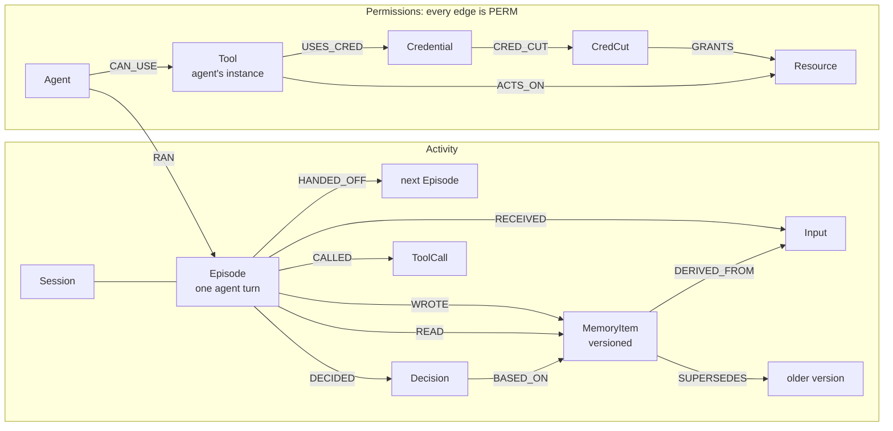

# Technical notes

Detail moved out of the README. Back to the [README](../README.md).

## Benchmarks

**Store concurrency** (`pnpm bench`, Apple Silicon, native arm64 images, one shared client connection, 60 ops
per agent, 40% puts / 60% full-text searches):

| Engine | Agents | Ops/s | Read p50 / p95 (ms) | Write p50 / p95 (ms) |
| ------ | -----: | ----: | ------------------: | -------------------: |
| 6.0.2  |      8 |  1219 |           8.3 / 8.9 |            4.1 / 4.5 |
| 6.0.2  |     16 |  1251 |         16.2 / 17.0 |            8.1 / 8.7 |
| 6.0.2  |     32 |  1221 |         33.1 / 36.4 |          16.3 / 18.2 |
| 4.22.1 |      8 |  1422 |           7.1 / 7.9 |            3.4 / 4.1 |
| 4.22.1 |     16 |  1305 |         15.4 / 16.9 |            7.6 / 8.8 |
| 4.22.1 |     32 |  1068 |         34.8 / 56.9 |          17.1 / 26.6 |

Throughput is flat and latency grows linearly with agents on both engines: the single client connection is the
bottleneck, not the engine. We make no MVCC claim for 6.0 from this; 6.0 does hold its tail latency better at 32
agents.

## Internals



**One write path.** Everything (the live swarm, replay, fixtures, the eval generator, config scans) produces
events, and `applyEvents` is the only code that writes them: validated with zod, applied in time order, `MERGE`d
on stable ids with `ON CREATE`, failing loudly on a dangling reference. Replaying a log twice yields the same
graph hash, and a recorded live run replays to the identical graph.

**One read path.** `run()` is the only way to reach the database. Every statement is registered with a name and
description (they are listed below), reads go through `GRAPH.RO_QUERY` so a registered read cannot mutate, every
statement has a `TIMEOUT`, and every call lands in a redacted query log that the UI streams.

**Bitemporal memory.** A put never overwrites: it writes a new `MemoryItem` that `SUPERSEDES` the current one and
closes it (`valid_to`). `FalkorDBStore` is a LangGraph `BaseStore` over this model, so the agents' own memory
reads and writes become `READ` and `WROTE` edges on the exact version they touched, with `DERIVED_FROM`
provenance to the inputs they had seen.

**Temporal trace.** Earliest-arrival relaxation to a fixpoint. The seed is the poisoned version; its writer is
patient zero. Each round sends the frontier through four registered queries (`trace.wrote`, `trace.read`,
`trace.handoff`, `trace.derived`), each with its time comparison inside Cypher: an edge carries infection only if
it happened at or after its source was infected. Every node keeps its earliest arrival and the edge that caused
it; only improved nodes are relaxed next round. Decisions are flagged if made by an infected episode after
infection or if they cite an infected version.

**Naive baseline.** The same rules with time ignored and memory identified by `(ns, key)`, which is what "who
touched the refund SOP?" looks like without versions. It is what the eval compares against.

**Minimum-cost quarantine.** Infected agents are the sources, sensitive resources the sinks, revocation cost the
capacity. `algo.maxFlow` gives the flow; we build the residual graph in TypeScript, BFS from the sources, and cut
every edge leaving the reachable side. We assert the cut's cost equals the max flow and that no structural edge is
in it, and the eval checks it against an exhaustive search. Credentials are modelled as their own edge
(`CRED_CUT`), so rotating one shared key can be cheaper than revoking several tools.

**Apply.** Revocation sets `revoked_at` and `capacity: 0` and keeps the cost for audit. The poison and everything
derived from it are marked invalidated, so the store stops serving them at once, and the clean version is
restored as a new version that `SUPERSEDES` the poison. Apply requires `confirm: true` and is idempotent.

### Where the brief met reality

Found by `pnpm smoke` and the tests, on both engines:

- `algo.maxFlow` accepts **exactly one** relationship type and requires `capacityProperty`, so the permission
  network is a single `PERM` type with a `kind`, and revocation is `capacity: 0` rather than deletion.
- Tool nodes are **per-agent instances**. Shared tool nodes let Billing reach the CRM through Analytics' database
  credential via a common `postgres.query` node.
- `roQuery` on a missing graph fails with `empty key`, mapped to `GraphNotReady`.
- 6.0 changed the arity of `db.idx.fulltext.createNodeIndex`; Cypher DDL works on both.
- On 4.22.1, `a STARTS WITH $p + '/'` parses as `(a STARTS WITH $p) + '/'`. The benchmark caught it; CI now runs
  the whole suite and the eval on both engines.

## API and MCP

Contract: [packages/graph/src/types/api.ts](packages/graph/src/types/api.ts) (zod). Errors are always
`{ error: { code, message } }`. Validated samples of every response: [apps/web/mocks](apps/web/mocks).

| Method | Path                                  | Purpose                                                 |
| ------ | ------------------------------------- | ------------------------------------------------------- |
| GET    | `/api/health`                         | Engine reachability and tenant load state               |
| GET    | `/api/incidents/:seed?mode=`          | Temporal or naive trace, plus the naive false positives |
| GET    | `/api/incidents/:seed/stream`         | SSE: the trace round by round, then the incident        |
| GET    | `/api/incidents/:seed/timeline`       | Every action in order, marked infected or naive-only    |
| GET    | `/api/incidents/:seed/reach`          | Live paths from infected agents to sensitive resources  |
| POST   | `/api/incidents/:seed/plans`          | Compute and store the min-cost quarantine               |
| GET    | `/api/plans/:id`                      | A stored plan                                           |
| POST   | `/api/plans/:id/apply`                | Apply with `{ "confirm": true }`                        |
| GET    | `/api/memory?q=`                      | Memory keys with every version                          |
| GET    | `/api/queries`, `/api/queries/stream` | The Cypher log (snapshot, or SSE for your graph)        |
| POST   | `/api/scan`                           | Reach and cut for your own MCP configs                  |
| POST   | `/api/demo/reset`                     | Fresh copy of the demo graph                            |
| GET    | `/api/eval`                           | Latest eval results                                     |
| POST   | `/api/mcp`                            | MCP over Streamable HTTP (also `pnpm mcp` on stdio)     |

MCP tools: `search_memory`, `trace_incident`, `incident_timeline`, `incident_reach` (read-only),
`plan_quarantine` (idempotent), `apply_quarantine` (destructive, needs `confirm`). The **Sentinel** is a LangGraph
agent that investigates an alert using only these tools; its calls are recorded and `pnpm sentinel --replay`
re-executes them against the graph to check nothing drifted.

## Setup

Requirements: Node 24, pnpm 11, Docker (OrbStack works).

```sh
pnpm install
cp .env.example .env              # OPENROUTER_API_KEY and LLM_MODEL only needed for record/sentinel
docker compose up -d              # FalkorDB 6.0.2 on 6379, browser on http://localhost:3001
pnpm replay                       # load fixtures into tenant graphs
pnpm dev                          # http://localhost:3000/debug
```

| Command                                           | What it does                                              |
| ------------------------------------------------- | --------------------------------------------------------- |
| `pnpm typecheck && pnpm lint && pnpm test`        | Gates (tests need FalkorDB running)                       |
| `pnpm smoke [ports]`                              | Engine capability matrix                                  |
| `pnpm replay [--if-missing]`                      | Rebuild tenant graphs from `fixtures/`                    |
| `pnpm mocks`                                      | Regenerate validated API samples for the UI               |
| `pnpm eval`                                       | 20-scenario evaluation, writes `eval/results/latest.json` |
| `docker compose --profile v4 up -d && pnpm bench` | Benchmark 6.0.2 and 4.22.1                                |
| `pnpm record --runs 10`                           | Live attack runs through OpenRouter                       |
| `pnpm sentinel [--replay]`                        | Live Sentinel investigation, or replay check              |
| `pnpm readme`                                     | Regenerate the Cypher section below from the registry     |

Layout: `packages/graph` (model, queries, trace, permissions, store, API builders, MCP server, eval),
`packages/swarm` (LangGraph swarm, recorder, sandbox, Sentinel), `apps/web` (Next 16 routes and `/debug`),
`fixtures/` (event logs, MCP configs, the poisoned page), `scripts/`.

Deploy: see [docs/deploy-railway.md](docs/deploy-railway.md) (two Railway services, private networking, password
auth, volume, `REPLAY_FORCE=1` to reload changed fixtures).
